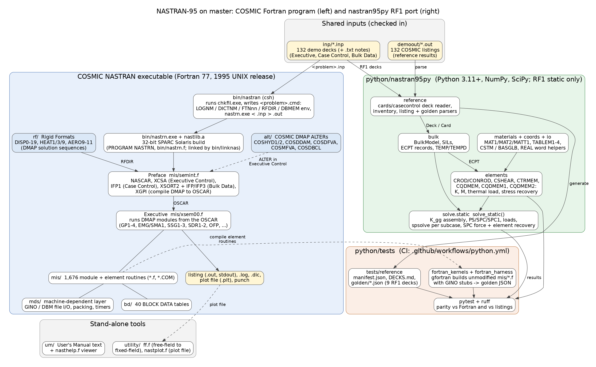

# NASTRAN-95 architecture

This repository holds two things that share the same demo decks:

1. **The COSMIC NASTRAN-95 program**: the April 1995 UNIX release of the NASA
   Structural Analysis System in Fortran 77 (`mis/`, `bd/`, `mds/`, `rf/`,
   `alt/`, `bin/`), unchanged from the NASA release.
2. **`nastran95py`** (`python/`): a Python/NumPy port of the Rigid Format 1
   (static analysis) element routines plus a minimal RF1 static solve, checked
   number by number against the compiled Fortran and the COSMIC listings.

The diagram source is [`diagrams/architecture.dot`](diagrams/architecture.dot)
(Graphviz). After editing it, run `docs/diagrams/render.sh` to regenerate
`architecture.png` and `architecture.svg`.

## Repository layout

| Path | What it is |
|---|---|
| `mis/` | 1,676 Fortran routines (`*.f`) and two COMMON include files: the preface, the DMAP executive, every functional module (GP1-GP4, EMG, SMA1/SMA2, SSG1-SSG4, SDR1-SDR3, OFP, the eigensolvers, ...) and the element routines |
| `bd/` | 40 `BLOCK DATA` units (module and card tables, output formats) |
| `mds/` | Machine-dependent layer: GINO / DBM file and matrix I/O (open, read, write, pack/unpack), bootstrap, timers, and `.COM` include files |
| `rf/` | Rigid Formats: the DMAP solution sequences `DISP0`-`DISP19`, `HEAT1/3/9`, `AERO9-11`, plus `NASINFO` (site defaults and messages) |
| `alt/` | COSMIC DMAP ALTER packages: hydroelastic analysis (`COSHYD1`, `COSHYD2`), DDAM (`COSDDAM`), direct and modal forced vibration of cyclic structures (`COSDFVA`, `COSMFVA`) and delamination buckling (`COSDBCL`) |
| `bin/` | The UNIX build: `nastran` (csh driver), `nastrn.f` (main program), `linknas` (link script), `nastlib.a`, and the 32-bit SPARC Solaris binaries `nastrn.exe` and `chkfil.exe` |
| `inp/` | 132 demonstration and test decks (`d*.inp`, `t*.inp`) and 83 `.txt` problem descriptions |
| `demoout/` | 132 COSMIC listings (`.out`) for the decks in `inp/` |
| `um/` | User's Manual sections as text and the `nasthelp.f` viewer |
| `utility/` | Stand-alone programs: `ff.f` (free-field to fixed-field deck converter) and `nastplot.f` (plot file translator) |
| `python/` | The `nastran95py` package, its tests and the gfortran harnesses ([README](../python/README.md)) |
| `.github/workflows/python.yml` | CI for `python/` (ruff, reference manifest check, Fortran harness build, pytest) |
| `*.pdf`, `*.doc` | NASTRAN Programmer's Manual, User's Manual and the NASA Open Source Agreement 1.3 |

## The Fortran program

### Running a deck

`bin/nastran <problem>` is an interactive csh script. It names the files
after the problem (`<problem>.inp` input, `.out` listing, `.log`, `.dic`,
`.plt`, `.pch`), runs `chkfil.exe` on the deck, asks about scratch and
memory settings, and writes `<problem>.cmd`. That script passes the file
names to the executive as environment variables (`LOGNM`, `DICTNM`,
`PLTNM`, `PUNCHNM`, `NPTPNM`, `OPTPNM`, `FTN11`-`FTN23`, `SOF1`/`SOF2`,
`DIRCTY` for scratch, `RFDIR` for the Rigid Formats, `DBMEM`/`OCMEM` for the
in-memory database and open core sizes) and runs
`nastrn.exe < <problem>.inp > <problem>.out`. `bin/nastran` then offers to
run the script in the foreground or background.

### Inside `nastrn.exe`

1. `PROGRAM NASTRN` (`bin/nastrn.f`) records start times, calls `BTSTRP`,
   sizes the database and open core from `DBMEM`/`OCMEM` and calls the
   executive.
2. **Preface** (`SEMINT`, `mis/semint.f`): `NASCAR` reads the optional NASTRAN
   card, `XCSA` reads Executive Control (`APP`, `SOL`, `ALTER`, ...), `IFP1`
   reads Case Control, `XSORT2` sorts Bulk Data and `IFP`/`IFP3` check and
   write it to the GINO data blocks. `XGPI` takes the chosen Rigid Format from
   `rf/` (with any `ALTER` from the deck or from `alt/`) and compiles the DMAP
   into the OSCAR (operation sequence).
3. **Executive** (`XSEM00`, `mis/xsem00.f`) walks the OSCAR and runs each
   module with its file and parameter tables. For a static run (Rigid Format 1,
   `DISP1`) that is, in outline: GP1-GP4 (geometry, coordinate systems,
   constraints and DOF sets), TA1 (element tables), EMG/EMA or SMA1/SMA2
   (element stiffness and mass, assembled `KGG`/`MGG`), SSG1 (loads), SSG2/SSG3
   (reduce and solve), SDR1/SDR2 (displacements, SPC forces, element forces and
   stresses) and OFP (printed output).
4. All intermediate data blocks and matrices go through GINO in `mds/`, backed
   by scratch files or the in-memory DBM database.

The result is the printed listing on stdout, `<problem>.out` (what `demoout/*.out` holds), plus the log,
dictionary, plot file (`utility/nastplot.f` reads it) and punch output.

### Building

`bin/linknas` extracts the main program and BLOCK DATA objects from
`nastlib.a` and links them with Sun `f77 -fast`. There is no makefile for the
library itself and `nastrn.exe` only runs on SPARC Solaris, so on other machines
the listings in `demoout/` are the Fortran reference. The Python test harnesses
compile the individual routines they need with gfortran instead (below).

## nastran95py

`nastran95py` ports what an RF1 static run needs for the CROD/CONROD, CSHEAR,
CTRMEM, CQDMEM, CQDMEM1 and CQDMEM2 elements. It keeps the Fortran inputs
(MPT material records, CSTM coordinate records, EST/ECPT element records) and
emulates single-precision REAL arithmetic where the Fortran uses it. It has no
DMAP sequencing, GINO I/O or grid point resequencing.

| Subpackage | Role | Fortran counterpart |
|---|---|---|
| `reference` | Fixed/free-field card reader, Executive and Case Control parser, RF1 deck inventory (`tests/reference/manifest.json`, `DECKS.md`), listing and golden-value parsers | `inp/`, `demoout/` |
| `bulk` | `BulkModel` (GRID, CORD, MAT, element and property cards, SPC/SPC1, FORCE/MOMENT, TEMP/TEMPD), SILs, ECPT records | IFP, GP1, TA1 |
| `materials` | MAT1, MAT2, MATT1 with TABLEM1-4 | `MAT` in `mis/premat.f` |
| `coords` | CSTM records, CORD1/CORD2, basic/global transforms | `mis/pretrs.f`, `mis/pretrd.f`, `mis/basglb.f`, GP1 |
| `elements` | ECPT contract (`ElementData`, `EcptLayout`) and the element kernels: stiffness, mass, thermal (and ROD `DEFORM`) loads, stress and force recovery, each with scalar and batched paths | EMG/SMA1 (`rodd`, `sheard`, `ktrmem`, `kqdmem`, `qdmm1d`, `qdmm2d`, ...), EDTL loads, SDR2 (`srod1/2`, `spanl1/2`, `strme1`, `sqdme1`, `sqdm11/12/21/22`, `stqme2`) |
| `solve` | `solve_static()`: sparse `K_gg` assembly, GRID/GRDSET `PS` and SPC/SPC1 constraints, LOAD/FORCE/MOMENT and thermal loads, `scipy` sparse LU per subcase, SPC force and element recovery | SMA1, GP4/SCE1, SSG1, SSG2/SSG3, SDR1/SDR2 |
| `io` | 32-bit INTEGER/REAL word reinterpretation, Fortran `D` exponents | GINO word handling |

Cards and Case Control the solver does not handle (MPC, OMIT/ASET, SUPORT,
SPCD, DEFORM, subcase combinations) raise `NotSupported`; PARAM, CNGRNT and
POPT/PLIMIT are ignored, so d01161a's fully stressed design loop is not run.

### How it is checked

- **Against the Fortran source**: `python/tests/fortran_kernels/` and
  `python/tests/fortran_harness/` compile the unmodified routines from `mis/`
  with gfortran, linked to small GINO/CSTM stubs and drivers. The `*_cases.py`
  scripts run them and write `golden/*.json`; pytest feeds the same inputs to
  the Python kernels and compares.
- **Against the listings**: `python/tests/reference/golden/*.json` holds the
  displacements, SPC forces, OLOAD, element forces and stresses parsed from
  `demoout/` for the nine RF1 decks (d01011a-d01014a, d01032a-d01034a, d01161a,
  t01241a). `tests/test_solve_static.py` solves each deck and compares every
  table at the golden-file tolerance.
- **CI** (`.github/workflows/python.yml`, on changes under `python/`, `mis/`,
  `inp/`, `demoout/`): Python 3.11 and 3.12 with ruff, the manifest staleness
  check, both harness builds and the full pytest run, plus a NumPy 1.26 job for
  the element and solve tests. `NASTRAN95PY_REQUIRE_FORTRAN=1` turns a missing
  gfortran into a failure instead of a skip.

See [`python/README.md`](../python/README.md) for usage and the commands that
regenerate each golden file.
